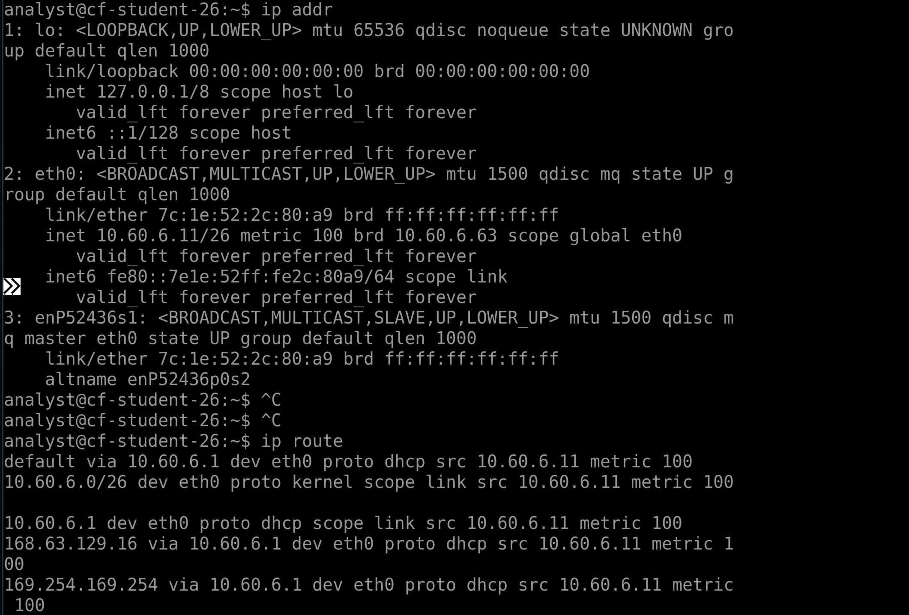
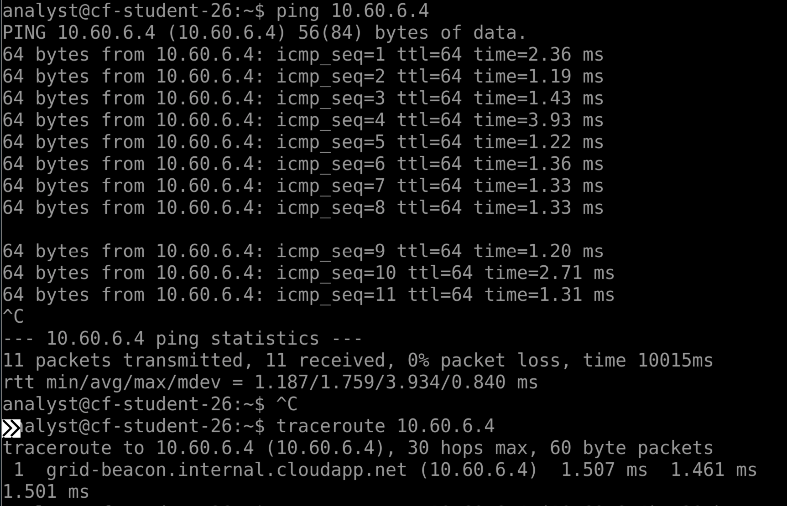

# Week 6 Lab 03 — The Grid, For Real

**Student Name:** Joya Jones

**Date Completed:** 11/3/2026

**Module:** 2 — Networking & Cloud Foundations | **Week:** 6  
**Submission Path:** `week-06/labs/lab-03-the-grid-for-real.md`

---

> ### 🔒 Cloud Heights Security Rule
> Your Bastion link and Cloud Heights password are **private access credentials**. Never paste either into a worksheet, screenshot, GitHub repository, Circle post, or chat message. When taking screenshots, crop out the browser address bar and all login information.

---

## Overview

In Week 5 you ran `ip addr`, `ip route`, `ping`, and `traceroute` in a simulator that always behaved. Today you run the same toolkit against real cloud infrastructure that does **not** always behave the way the textbook implies — and you learn to tell "broken" apart from "normal."

This is an **independent** lab. It tells you what to accomplish; you choose the commands. Expect about 40 minutes.

---

## Lab Environment / Pre-Lab Check

| Component | Details |
|---|---|
| Environment | Cloud Heights — live Ubuntu 22.04 VM, reached through Azure Bastion |
| Commands used | `ip addr`, `ip route`, `ping`, `traceroute`, `curl` |
| Known-good target | **Grid Beacon — `10.60.6.4`** |
| Prerequisite | Week 6 Labs 01–02 |

---

## Part A — Where You Actually Are

### Step 1 — Read Your Own Address

Run the command that lists your interfaces and addresses.

Command and output:

```
ip addr

1: lo: <LOOPBACK,UP,LOWER_UP> mtu 65536 qdisc noqueue state UNKNOWN gro
up default qlen 1000
    link/loopback 00:00:00:00:00:00 brd 00:00:00:00:00:00
    inet 127.0.0.1/8 scope host lo
       valid_lft forever preferred_lft forever
    inet6 ::1/128 scope host 
       valid_lft forever preferred_lft forever
2: eth0: <BROADCAST,MULTICAST,UP,LOWER_UP> mtu 1500 qdisc mq state UP g
roup default qlen 1000
    link/ether 7c:1e:52:2c:80:a9 brd ff:ff:ff:ff:ff:ff
    inet 10.60.6.11/26 metric 100 brd 10.60.6.63 scope global eth0
       valid_lft forever preferred_lft forever
    inet6 fe80::7e1e:52ff:fe2c:80a9/64 scope link 
       valid_lft forever preferred_lft forever
3: enP52436s1: <BROADCAST,MULTICAST,SLAVE,UP,LOWER_UP> mtu 1500 qdisc m
q master eth0 state UP group default qlen 1000
    link/ether 7c:1e:52:2c:80:a9 brd ff:ff:ff:ff:ff:ff
    altname enP52436p0s2
```

Your private IPv4 address and prefix length:

```
10.60.6.11/26
```

### Step 2 — Read Your Route

Run the command that shows the routing table.

Command and output:

```
ip route

default via 10.60.6.1 dev eth0 proto dhcp src 10.60.6.11 metric 100 
10.60.6.0/26 dev eth0 proto kernel scope link src 10.60.6.11 metric 100
 
10.60.6.1 dev eth0 proto dhcp scope link src 10.60.6.11 metric 100 
168.63.129.16 via 10.60.6.1 dev eth0 proto dhcp src 10.60.6.11 metric 1
00 
169.254.169.254 via 10.60.6.1 dev eth0 proto dhcp src 10.60.6.11 metric
 100 
```

Your default gateway:

```
10.60.6.1

```

### Step 3 — Compare to Week 5

Compare this live Ubuntu output to what the CLI Simulator produced in Week 5. What looks the same, what looks different, and what surprised you:

```
Comparing live Ubuntu output to that of the CLI Simulator, I notice a third numbered output in Ubuntu for 'ip addr', in addition to 'lo' and 'eth0'. The 'ip route' output has three additional lines, two of which have been explained as "housekeeping" addresses that the cloud platform uses and we will never need, beginning in 168.63 and 169.254. 
I still see the information that I am looking for: my IP address and subnet prefix found under eth0, the default gateway address where I normally see it. I was surprised to see that the IP address representing the machine talking back to itself was the same for both machines: 127.0.0.1.
```

---

## Part B — The Gateway That Does Not Answer

### Step 1 — Ping the Gateway

Ping the default gateway address you recorded. Let it run a few seconds, then stop it.

Command and output:

```
ping 10.60.6.1
PING 10.60.6.1 (10.60.6.1) 56(84) bytes of data.
^C
--- 10.60.6.1 ping statistics ---
31 packets transmitted, 0 received, 100% packet loss, time 30711ms
```

### Step 2 — Interpret It Correctly

You almost certainly got **no replies**. In Azure, the platform gateway commonly does not answer ICMP. This is **expected platform behaviour** and by itself proves nothing about whether your machine or network is broken.

Explain why "the gateway did not answer ping" is weak evidence:

```
Microsoft has documented that the default gateway in Azure environments has been configured to not reply to 'ping's, which fall under the ICMP network message category. In this case, a professional would expect not to receive an answer to ping. This output would not serve as evidence of anything out of the ordinary. 
```

---

## Part C — The Known-Good Target

The **Grid Beacon** at `10.60.6.4` is a machine that is known to be up and known to answer. When your first probe fails, you test against something known-good before you conclude anything.

### Step 1 — Ping the Beacon

```
ping 10.60.6.4
```
Output:

```
PING 10.60.6.4 (10.60.6.4) 56(84) bytes of data.
64 bytes from 10.60.6.4: icmp_seq=1 ttl=64 time=2.36 ms
64 bytes from 10.60.6.4: icmp_seq=2 ttl=64 time=1.19 ms
64 bytes from 10.60.6.4: icmp_seq=3 ttl=64 time=1.43 ms
64 bytes from 10.60.6.4: icmp_seq=4 ttl=64 time=3.93 ms
64 bytes from 10.60.6.4: icmp_seq=5 ttl=64 time=1.22 ms
64 bytes from 10.60.6.4: icmp_seq=6 ttl=64 time=1.36 ms
64 bytes from 10.60.6.4: icmp_seq=7 ttl=64 time=1.33 ms
64 bytes from 10.60.6.4: icmp_seq=8 ttl=64 time=1.33 ms

64 bytes from 10.60.6.4: icmp_seq=9 ttl=64 time=1.20 ms
64 bytes from 10.60.6.4: icmp_seq=10 ttl=64 time=2.71 ms
64 bytes from 10.60.6.4: icmp_seq=11 ttl=64 time=1.31 ms
^C
--- 10.60.6.4 ping statistics ---
11 packets transmitted, 11 received, 0% packet loss, time 10015ms
rtt min/avg/max/mdev = 1.187/1.759/3.934/0.840 ms
```

### Step 2 — Trace the Path

```
traceroute 10.60.6.4
```
Output:

```
traceroute to 10.60.6.4 (10.60.6.4), 30 hops max, 60 byte packets
 1  grid-beacon.internal.cloudapp.net (10.60.6.4)  1.507 ms  1.461 ms  
1.501 ms
```

### Step 3 — Ask the Application

```
curl http://10.60.6.4
```
Output:

```
<!DOCTYPE html>
<html lang="en">
<head>
    <meta charset="UTF-8">
    <meta name="viewport" content="width=device-width, initial-scale=1.
0">
    <title>GRID BEACON | CVI CyberFoundations</title>
    <style>
        body {
            background: #071426;
            color: #d9f7ef;
            font-family: monospace;
            max-width: 850px;
            margin: 80px auto;
            padding: 30px;
        }
        .beacon {
            border: 1px solid #31d6a6;
            padding: 35px;
        }
        h1 { color: #31d6a6; }
        .label { color: #8ca8ff; }
        .status { color: #31d6a6; }
        .classified {
            margin-top: 30px;
            border-top: 1px solid #31445e;
            padding-top: 20px;
        }
   </style>
</head>
<body>
<div class="beacon">

    <h1>GRID BEACON</h1>

    <p><span class="label">NODE:</span> grid-beacon</p>
    <p><span class="label">NETWORK:</span> CVI Training Grid</p>
    <p><span class="label">STATUS:</span>
       <span class="status">ONLINE</span></p>

    <p>
        Network beacon established.<br>
        If you reached this node, your route is operational.
    </p>

    <div class="classified">
        <p>INVESTIGATION CHECKPOINT</p>

        <p>
            Observe the path that brought you here.
            The destination is only part of the story.
        </p>

        <p>TRACE ID: CF-NET-0604</p>
    </div>

</div>
</body>
</html>
```

> ### ⚠️ Grid Beacon not responding?
> The Grid Beacon is shared course infrastructure and should normally be available. First, confirm your Cloud Heights VM shows **Running** and that you completed the preceding network checks. Then retry the command once after a minute or two.
>
> If the Grid Beacon still does not respond, **stop this part of the lab and contact your instructor.** Record that the shared service was unavailable; do not treat the result as evidence that your VM or your work is incorrect.
>
> Do not change networking, NSGs, firewall rules, routes, DNS, or any Azure settings to try to reach the beacon.
>
> *Instructor note: a confirmed Grid Beacon outage is an environment issue, not a student error. Affected students may complete this portion of Lab 03 after the service is restored, with no penalty.*

### Step 4 — Record the Application Evidence

The beacon returns a banner and a trace ID. Record exactly what you received:

```
 <h1>GRID BEACON</h1>

    <p><span class="label">NODE:</span> grid-beacon</p>
    <p><span class="label">NETWORK:</span> CVI Training Grid</p>
    <p><span class="label">STATUS:</span>
       <span class="status">ONLINE</span></p>

    <p>
        Network beacon established.<br>
        If you reached this node, your route is operational.
    </p>

    <div class="classified">
        <p>INVESTIGATION CHECKPOINT</p>

        <p>
            Observe the path that brought you here.
            The destination is only part of the story.
        </p>

        <p>TRACE ID: CF-NET-0604</p>
```

Explain the difference between what the `ping` proved and what the `curl` proved:

```
The 'ping' proved that Grid Beacon is network connected and responding. The 'curl' proved that its web server application is working. Each command asks one, and only one question. 
```

### Step 5 — Capture Your Evidence

Two screenshots, both cropped to the terminal only:

**Required filename:** `vm-toolkit-live.png` — your `ip addr` and `ip route` output



**Required filename:** `beacon-reply.png` — your beacon ping/traceroute/curl evidence



---

## Part D — Rewrite the Ladder Rule

Week 5 taught the Ladder Rule: test the near thing before the far thing. Real infrastructure adds a wrinkle — a silent rung is not automatically a broken rung.

Rewrite the Ladder Rule in your own words so that it survives real cloud infrastructure. Your version must include both **route/path evidence** and **a known-good target**:

```
The Ladder Rule provides a proven, 5-rung network troubleshooting method that helps to diagnose network connectivity issues. It progresses from the closest point outward, and allows the accumulation of evidence to determine what, if anything, has gone wrong. First, you check yourself for an IP address, evidence of your place on the network. Then, you check that your default gateway is configured using 'ip route', followed by a test to a destination beyond the gateway to confirm that it can successfully forward traffic. You can also 'ping' a known-good, reliable target to confirm local network connectivity, although this alone does not prove that the gateway is working. After this, you 'ping' the desired target for troubleshooting by NAME, followed by IP address directly to rule out DNS lookup issues. Finally, use 'traceroute' to examine the path between us and the desired target and help identify where communication may be breaking down.
```

---

## Analysis Questions

**Analysis Question 1.** Your ping to the gateway failed and your ping to the beacon succeeded. What does that pair of results, taken together, prove about your machine's networking? *(Minimum 3 sentences.)*

```
The successful ping to the grid beacon confirms that my virtual machine can communicate with another device on its local subnet. The default gateway did not respond to 'ping', but this is expected behavior in Azure environments and does not allow us to conclude anything about its capabilities. We cannot conclude that the VM can successfully communicate with machines outside of the local network because we have not yet tested its ability to reach a target beyond.
```

**Analysis Question 2.** Why is `traceroute` useful even when `ping` already answered? What extra thing does it show you? *(Minimum 2 sentences.)*

```
The 'traceroute' command shows the hops along the path that a network message takes to reach its intended destination. A 'ping' tells whether a reply came back from the intended destination directly. Ultimately 'traceroute' will let you know where on the path return communication may be breaking down.
```

**Analysis Question 3.** A service is unreachable and ping to it succeeds. Where would you look next, and why is "the network is fine" an incomplete answer? *(Minimum 3 sentences.)*

```
A network device's ability to respond to 'ping' does not tell you anything about the availability or functionality of a service that lives there. Next, you need to run a test that corresponds to the unreachable service. For HTTP/HTTPS functionality, the 'curl' command will provide evidence for whether it works. 
```

**Analysis Question 4.** Something already controls what is allowed to reach your machine in Cloud Heights. If you could decide those rules, what would you want to allow, what would you want to block, and who in an organization should get to make that decision? *(Minimum 3 sentences.)*

```
If I could decide the rules that would govern what reaches my VM, I would allow only the connections necessary for my work that I explicitly authorize as opposed to permitting everything by default. I would block connections from the open internet, while allowing approved access for administrators or instructors to provide support. In a real organization, the network administrator should be responsible for creating and managing access rules.
```

---

## Submission Checklist

- [x] `ip addr` output recorded and own private IP/prefix identified (Part A)

- [x] `ip route` output recorded and default gateway identified (Part A)

- [x] Live output compared to the Week 5 simulator (Part A, Step 3)

- [x] Gateway pinged and the silent result interpreted correctly (Part B)

- [x] Beacon `ping`, `traceroute`, and `curl` all run and recorded (Part C)

- [x] Beacon banner and TRACE ID recorded (Part C, Step 4)

- [x] `vm-toolkit-live.png` and `beacon-reply.png` captured, cropped, uploaded to `assets/screenshots/week-06/` (Part C, Step 5)

- [x] Ladder Rule rewritten with route evidence + known-good target (Part D)

- [x] All four Analysis Questions answered (minimum sentence counts met)

- [x] This file is committed to your portfolio repo at `week-06/labs/lab-03-the-grid-for-real.md`

---

## GitHub Commit Subsection

1. Open **Week 6 → Lab 03: The Grid, For Real** in the Lab Portal.
2. Fill in the worksheet fields and upload both screenshots to `assets/screenshots/week-06/`.
3. Click **Submit to GitHub** — the Portal commits to `week-06/labs/lab-03-the-grid-for-real.md`.

---

*CyberVisionaries Institute · Cyber Foundations · Tier I*
