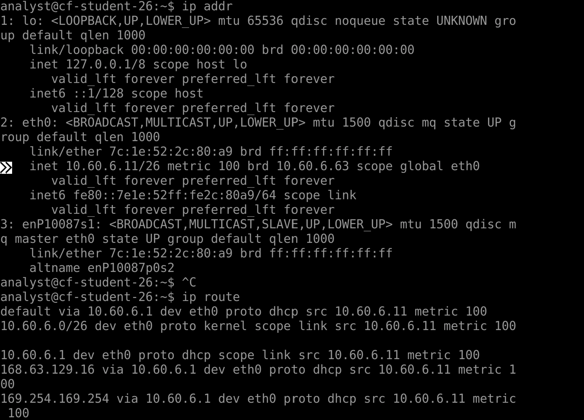

# Week 6 Lab 04 — Reading the Blueprints

**Student Name:** Joya Jones

**Date Completed:** 11/3/2026

**Module:** 2 — Networking & Cloud Foundations | **Week:** 6  
**Submission Path:** `week-06/labs/lab-04-reading-the-blueprints.md`

---

> ### 🔒 Cloud Heights Security Rule
> Your Bastion link and Cloud Heights password are **private access credentials**. Never paste either into a worksheet, screenshot, GitHub repository, Circle post, or chat message. When taking screenshots, crop out the browser address bar and all login information.

---

## Overview

**This is a SHORT lab — 15 to 20 minutes.** It is deliberately small. You already have the commands; this lab is about matching a drawing to reality.

The **Cloud Heights Network Blueprint** is displayed at the top of this lab page in the portal. Everything you write about the network's architecture comes from that blueprint or from your own machine — never from a guess.

---

## Lab Environment / Pre-Lab Check

| Component | Details |
|---|---|
| Environment | Cloud Heights — live Ubuntu 22.04 VM, reached through Azure Bastion |
| Source of truth | The Cloud Heights Network Blueprint shown at the top of this lab page |
| Commands used | `ip addr`, `ip route` |
| Known value | Student subnet: **`10.60.6.0/26`** |

---

## Part A — Read the Drawing

### Step 1 — Record the Architecture Values

From the blueprint at the top of this page, record each value **exactly as drawn**. If a value is not shown on the blueprint, write "not shown on blueprint" — do not guess.

| Item | Value from the blueprint |
| --- | --- |
| VNet name | vnet-cf-labs |
| VNet address space | 10.60.6.0/24 |
| Student subnet range | 10.60.6.0/26 |

---

## Part B — Verify Against Your Own Machine

### Step 1 — Confirm Your Address Lives in the Subnet

Run `ip addr` and find your private IPv4 address.

Command and output:

```
ip addr

1: lo: <LOOPBACK,UP,LOWER_UP> mtu 65536 qdisc noqueue state UNKNOWN gro
up default qlen 1000
    link/loopback 00:00:00:00:00:00 brd 00:00:00:00:00:00
    inet 127.0.0.1/8 scope host lo
       valid_lft forever preferred_lft forever
    inet6 ::1/128 scope host 
       valid_lft forever preferred_lft forever
2: eth0: <BROADCAST,MULTICAST,UP,LOWER_UP> mtu 1500 qdisc mq state UP g
roup default qlen 1000
    link/ether 7c:1e:52:2c:80:a9 brd ff:ff:ff:ff:ff:ff
    inet 10.60.6.11/26 metric 100 brd 10.60.6.63 scope global eth0
       valid_lft forever preferred_lft forever
    inet6 fe80::7e1e:52ff:fe2c:80a9/64 scope link 
       valid_lft forever preferred_lft forever
3: enP10087s1: <BROADCAST,MULTICAST,SLAVE,UP,LOWER_UP> mtu 1500 qdisc m
q master eth0 state UP group default qlen 1000
    link/ether 7c:1e:52:2c:80:a9 brd ff:ff:ff:ff:ff:ff
    altname enP10087p0s2

```

Your private IP:

```
10.60.6.11/26
```

Explain how you know your address falls inside `10.60.6.0/26` — what range does that prefix actually cover:

```
The Cloud Heights VNet address space is 10.60.6.0/24, and the student-specific subnet is 10.60.6.0/26. The /26 prefix covers the address range 10.60.6.0 through 10.60.6.63. Because my private IP address 10.60.6.11/26 falls within that range, I know that it is part of the student subnet.
```

### Step 2 — Confirm Route Behaviour

Run `ip route`.

Command and output:

```
ip route

default via 10.60.6.1 dev eth0 proto dhcp src 10.60.6.11 metric 100 
10.60.6.0/26 dev eth0 proto kernel scope link src 10.60.6.11 metric 100
 
10.60.6.1 dev eth0 proto dhcp scope link src 10.60.6.11 metric 100 
168.63.129.16 via 10.60.6.1 dev eth0 proto dhcp src 10.60.6.11 metric 1
00 
169.254.169.254 via 10.60.6.1 dev eth0 proto dhcp src 10.60.6.11 metric
 100 

```

What the default route tells you about traffic that is not destined for your own subnet:

```
The default route tells me that traffic destined for outside of my local subnet will be passed through the default gateway at IP address 10.60.6.1.
```

### Step 3 — Capture Your Evidence

**Required filename:** `blueprint-verified.png`

This must be **your own `ip addr` and `ip route` output** — not a re-screenshot of the blueprint. Crop out the address bar and any login information.



---

## Part C — How Traffic Actually Moves

### Step 1 — No Public IP

Your VM has a private address and **no public IP**. Explain what that means for who can reach it directly from the internet:

```
Because my VM has no public IP address, no one can reach it directly from the internet. Unlike a door that has restricted access, the address is unreachable in this way because no public path exists.
```

### Step 2 — Outbound vs. Inbound

Outbound internet traffic from your VM leaves through address **translation (NAT)**. Inbound access for you arrives through **Azure Bastion**, not through a public address on the VM.

Explain both directions in your own words:

```
When my VM wants to reach the internet, it must pass through a translation step that serves as its temporary door to the public. NAT translates my VM's private IP address into a public-facing address, allowing it to communicate with the internet and receive replies. For inbound access, Azure Bastion provides a way for me to connect securely to my VM through my internet browser without requiring my VM to have its own public IP address.
```

### Step 3 — The Guard Post You Do Not Touch Yet

Each student machine sits behind its own **network security group** — a per-student guard post that decides what traffic is allowed in.

**In Week 6 you do not configure it.** Week 7 is when you take control of those rules.

Write one sentence naming what the guard post does and one sentence stating what you are *not* doing with it this week:

```
The guard post determines what traffic is allowed into my VM vs denied, based on a set of access rules. This week, I am not taking control over or configuring these rules.
```

---

## Analysis Questions

**Analysis Question 1.** Why would an organization put every student machine in one small subnet instead of giving each machine a public address? *(Minimum 3 sentences.)*

```
Giving every student machine a public IP address would create unnecessary security risks, especially while they are still learning how to manage access rules. By putting the machines in one small, private subnet, the organization limits their direct exposure to the public internet. Students can still access their VMs through Azure Bastion and communicate with the internet using NAT, without requiring the machines to have their own public IP addresses.
```

**Analysis Question 2.** Segmentation means separating a network into parts that cannot freely reach each other. Give one concrete benefit of segmentation during a security incident. *(Minimum 3 sentences.)*

```
One concrete benefit of network segmentation during a security incident is that it can limit the spread of an attack across an organization's networked devices. Without segmentation, an attacker who gains access to one machine could quickly compromise additional machines, potentially using different attack methods along the way. By separating the network into smaller sections and using access rules to control traffic between them, an organization can make it harder for an attacker to access machines in other departments or reach databases containing sensitive information. This can help contain the incident and allow the security team to focus resources on the affected area.
```

**Analysis Question 3.** A diagram and a live machine disagree about an address range. Which do you trust, what do you do next, and why? *(Minimum 2 sentences.)*

```
When a diagram and a live machine disagree about an address range, I trust the machine to tell me where it is currently located. A network diagram represents how the network was designed to be configured, and the live machine provides evidence of its actual configuration. In order to explore the discrepancy, I would go to the network administrator to confirm the intended configuration to determine whether the diagram was outdated or the machine was set up incorrectly.
```

---

## Submission Checklist

- [x] VNet name, address space, and subnet range recorded from the blueprint (Part A)

- [x] `ip addr` run and own private IP confirmed inside `10.60.6.0/26` (Part B, Step 1)

- [x] `ip route` run and default route behaviour explained (Part B, Step 2)

- [x] `blueprint-verified.png` captured from your own terminal, cropped, uploaded to `assets/screenshots/week-06/` (Part B, Step 3)

- [x] Private address / NAT / Bastion explained (Part C, Steps 1–2)

- [x] Per-student guard post identified — and explicitly not configured this week (Part C, Step 3)

- [x] All three Analysis Questions answered (minimum sentence counts met)

- [x] This file is committed to your portfolio repo at `week-06/labs/lab-04-reading-the-blueprints.md`

---

## GitHub Commit Subsection

1. Open **Week 6 → Lab 04: Reading the Blueprints** in the Lab Portal.
2. Fill in the worksheet fields and upload `blueprint-verified.png` to `assets/screenshots/week-06/`.
3. Click **Submit to GitHub** — the Portal commits to `week-06/labs/lab-04-reading-the-blueprints.md`.

---

*CyberVisionaries Institute · Cyber Foundations · Tier I*
