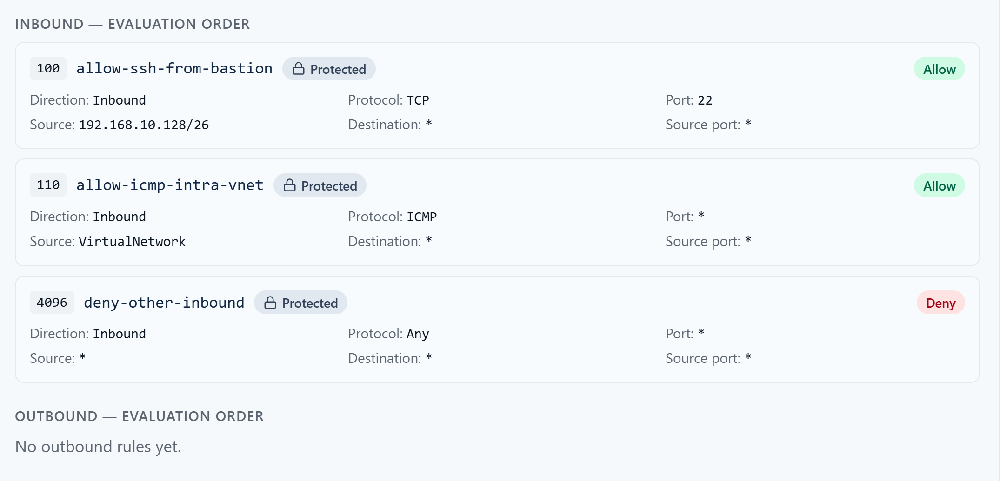

# Week 7 Lab 02 — Read the Door Ledger

**Student Name:** Joya Jones

**Date Completed:** 11/8/2026

**Module:** 2 — Networking & Cloud Foundations | **Week:** 7  
**Submission Path:** `week-07/labs/lab-02-read-the-door-ledger.md`

> ## Cloud Heights Protected-Rules Safety Rule
> Your room uses one of two protected baselines. Check your own **INBOUND — EVALUATION ORDER** list to see which one you have:
>
> | Baseline | Protected rules you will see | Fallback for TCP 8080 |
> |---|---|---|
> | **Legacy (four rules)** | 100 `allow-ssh-from-bastion`, 110 `allow-icmp-intra-vnet`, 120 `deny-ssh-student-subnet`, 1000 `deny-tcp8080-student-subnet` | Priority **1000** denies TCP 8080 from `10.60.6.0/26` |
> | **Newer (three rules)** | 100 `allow-ssh-from-bastion`, 110 `allow-icmp-intra-vnet`, 4096 `deny-other-inbound` | Priority **4096** explicitly denies all other inbound traffic (any protocol, source and port) |
>
> **Protected** rules (priorities 100/110, plus 120 and 1000 in legacy rooms, or 4096 in newer rooms) are course infrastructure: they are locked, and you must never modify them. Azure also has built-in default rules (priorities 65000–65500) that the Portal does not list; do not record them unless your ledger actually shows them. **Your editable range is 200–999.** Every student rule is read before either fallback. Write down the rule set your Portal actually shows; do not copy rules from the other baseline or invent missing ones. Use only inbound TCP 8080 rules from `10.60.6.4` to your assigned VM in Labs 03–05; never create SSH, ICMP, Any-protocol or outbound rules for these exercises. Bastion SSH and ICMP are matched by the earlier protected allows at 100/110 in both baselines. Honest diagnosis of a student-range mistake is not a grading penalty.

> **Evidence safety:** Never include a Cloud Heights password or Bastion shareable URL. Crop browser address bars and login information before committing screenshots.

---

## Mission

Learn to read inbound and outbound rule ledgers in evaluation order. Translate a rule from field values into plain English, then predict which matching rule makes the decision.

## What You Already Know

A network security rule is a decision about traffic. Rules are evaluated from the lowest priority number to the highest, and the first matching rule wins. Inbound and outbound traffic use separate ledgers. A configured service, a security rule, a test result, and an evidence screenshot answer different questions.

## Lab Environment / Pre-Lab Check

| Component | Details |
|---|---|
| Environment | Cloud Heights → Security Rules |
| Change level | Read-only reasoning |
| Evaluation | Lower priority number first; first match wins |
| Time | 25–30 minutes |

- [x] I am using my assigned `cf-student-XX` VM through the CyberFoundations Lab Portal.

- [x] The VM shows **Running**.

- [x] I can identify every protected rule in my actual baseline (legacy 100/110/120/1000 or newer 100/110/4096).

- [x] I understand that my editable priority range is 200–999.

### Cloud Heights Idle Stop

Cloud Heights may warn you that the VM is idle. Return to the Lab Portal and choose **I'm still working** if you are active. If the VM is stopped or deallocated, it was not deleted: restart it from **My Lab Environment**. Your disk files and saved configuration remain.

## Predict First

The priorities **250**, **300**, and **350** used in this lab are **hypothetical examples on paper only — do not create them**. This lab is prediction-only: do not add, edit, or delete rules, and do not run **Test My Rule** unless your instructor tells you to.

Remember the live baseline also contains the protected fallback in your actual ledger: **1000** `deny-tcp8080-student-subnet` on legacy rooms or **4096** `deny-other-inbound` on newer rooms (legacy: TCP 8080 from the student subnet; newer: Any protocol, source and port), which is reached only when no earlier rule matches.

Two inbound rules match TCP 8080 from the same source: priority 250 is **Deny** and priority 300 is **Allow**. Predict the verdict before reading further.

```text
TCP traffic to port 8080 from that source will be denied because the rule of lower priority number 250 will take precedence.
```

## Guided Steps

### Step 1 — Separate the Ledgers

Scroll below the yellow protected-rules summary to the detailed lists headed **INBOUND — EVALUATION ORDER** and **OUTBOUND — EVALUATION ORDER**. Read the inbound list, then the outbound list. Record one sentence explaining why a new outbound connection uses the outbound ledger, not an inbound Allow. Azure security rules are stateful: replies to an established allowed connection do not require a separate outbound Allow. An empty custom outbound list does not mean all outbound traffic is denied; Azure also has default outbound rules.

```text
A new outbound connection uses the outbound ledger as opposed to an inbound Allow because the VM is initiating the connection, not replying to an established inbound one.
```

### Step 2 — Translate a Rule

Choose one visible protected rule and translate it using this form:

> Read in the [direction] ledger at priority [number], [allow/deny] [protocol] traffic from [source]:[source port] to [destination]:[destination port].

```text
Read in Inbound ledger at priority 100, allow TCP traffic from 192.168.10.128/26 on any source port to any destination on port 22.
```

### Step 3 — Evaluate in Order

For each hypothetical scenario below, list the rules in evaluation order, identify the first matching rule, and state the verdict. These rules are imaginary — do not create them.

1. Priority 250 Deny TCP from `10.60.6.4` to port 8080; priority 300 Allow the same traffic.
2. Priority 300 Allow TCP from `10.60.6.4` to port 8080; priority 350 Deny TCP from any source to port 8080.
3. An inbound Allow exists, but the traffic being evaluated is outbound.

```text
1. Priority 250 DENY TCP from 10.60.6.4 to port 8080; priority 300 Allow the same traffic; 250 matches; verdict - DENY
2. Priority 300 Allow TCP from 10.60.6.4 to port 8080; priority 350 Deny TCP from any source to port 8080; 300 matches; verdict - ALLOW
3. Inbound Allow exists; outbound traffic; no outbound rule visible/listed; verdict - depends on default Azure outbound rules in this case
```

## Stop & Check

If you find yourself reading the Allow you want and ignoring an earlier matching Deny, restart at the lowest priority number. The ledger stops at the first match.

## Test

Use the displayed rule list to predict whether Grid Beacon TCP 8080 would currently be explicitly allowed by a student rule. Do not press **Test My Rule** yet unless your instructor directs you; the service may not be listening.

## Capture Evidence

Capture the detailed **INBOUND — EVALUATION ORDER** view (and **OUTBOUND — EVALUATION ORDER** if your evidence needs it), then name the first matching hypothetical rule and the resulting verdict for each scenario in your worksheet.



## Explain

Write a five-sentence explanation of first-match-wins that a classmate could use without memorizing Azure terminology.

```text
Firewall rules are a set of instructions that determine whether network traffic is allowed or denied. The rules are evaluated in order of priority, with lower priority numbers being considered first. When traffic hits the firewall, the firewall checks each rule in order to determine whether the traffic makes a match with the conditions of that rule. Once a match is found, the firewall follows the rule's instruction to Allow or Deny the traffic and stops evaluating the remaining rules. This means that even if another rule further down the list also matches the traffic, it will never be seen or considered, as the first match has already determined the outcome.
```

## Required Evidence

Save screenshots in `assets/screenshots/week-07/`:

- `week07-lab02-evaluation-order.png`

Open each image at full size before submission. Confirm that no password, Bastion shareable URL, browser address bar, or unrelated private information is visible.

## Analysis Questions

**Analysis Question 1.** If a Deny at priority 300 and an Allow at priority 400 both match, which wins and why? (Minimum 3 sentences.)

```text
The Deny rule at priority 300 wins because it has a lower priority number than the Allow rule at 400. When the firewall checks the traffic, it reaches the Deny rule first, sees a match, and blocks the traffic. After that it stops evaluating. The Allow rule at 400 is never read or considered.
```

**Analysis Question 2.** Why do inbound and outbound rules have to be reasoned about separately? (Minimum 3 sentences.)

```text
Inbound and outbound rules have to be evaluated separately because they address different security risks. Inbound rules control who can initiate connections to and communicate with the VM, while outbound rules control where it can initiate connections and communicate. Because each direction has its own set of rules, the firewall needs to check the respective ledger to see whether the traffic is allowed or denied.
```

**Analysis Question 3.** How can an Allow rule be correct by itself but ineffective in the full ledger? (Minimum 3 sentences.)

```text
The full ledger holds all firewall rules in order of evaluation priority. An Allow rule can be correct and have traffic that matches it, but a rule with a lower priority number may match first, causing the Allow rule to never be evaluated. Once the firewall finds a match, evaluation ends. In this event, the Allow rule can be considered ineffective.
```

## Submission Checklist

- [x] Three scenarios evaluated in order

- [x] One live rule translated to plain English

- [x] Inbound and outbound ledgers distinguished

- [x] `week07-lab02-evaluation-order.png` captured

- [x] All protected rules in my actual baseline were left unchanged.

- [x] Every rule I created or edited used priority 200–999.

- [x] No password, Bastion URL, or browser address bar appears in my files.

- [x] This worksheet is committed to `week-07/labs/lab-02-read-the-door-ledger.md`.

## GitHub / Lab Portal Submission

1. Open **Week 7 → Lab 02: Read the Door Ledger** in the CyberFoundations Lab Portal.
2. Complete every worksheet field and confirm the listed evidence filenames.
3. Upload screenshots to `assets/screenshots/week-07/`.
4. Confirm your portfolio repository is connected, then choose **Submit to GitHub**.
5. Open the committed worksheet and each image on GitHub to verify formatting, legibility, and redaction.

*CyberVisionaries Institute · CyberFoundations · Tier I*

**Interpreting results:** A TCP connection success proves reachability at that moment, not which rule matched. A timeout marked DENIED means traffic appears blocked; it is not a flow-log verdict and can also reflect a routing or host-firewall problem. SERVICE_NOT_LISTENING means an immediate refusal; check the listener before altering rules. TEST_ERROR is not denial evidence. Each test opens a fresh connection; after a rule change, allow Azure to finish, refresh the ledger and wait at least 10 seconds before retesting. Never invent a successful or denied result.
