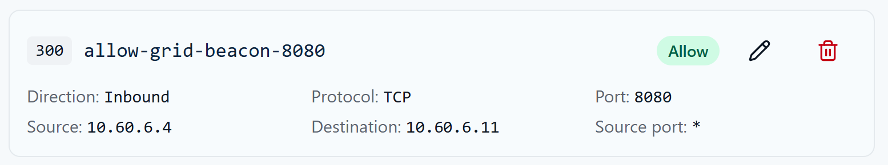
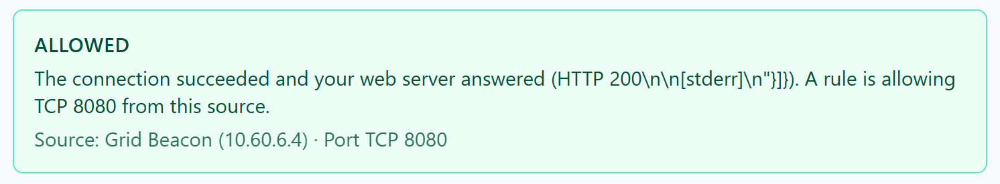

# Week 7 Lab 03 — Build the Narrowest Door

**Student Name:** Joya Jones

**Date Completed:** 11/8/2026

**Module:** 2 — Networking & Cloud Foundations | **Week:** 7  
**Submission Path:** `week-07/labs/lab-03-build-the-narrowest-door.md`

> ## Cloud Heights Protected-Rules Safety Rule
> Your room uses one of two protected baselines. Check your own **INBOUND — EVALUATION ORDER** list to see which one you have:
>
> | Baseline | Protected rules you will see | Fallback for TCP 8080 |
> |---|---|---|
> | **Legacy (four rules)** | 100 `allow-ssh-from-bastion`, 110 `allow-icmp-intra-vnet`, 120 `deny-ssh-student-subnet`, 1000 `deny-tcp8080-student-subnet` | Priority **1000** denies TCP 8080 from `10.60.6.0/26` |
> | **Newer (three rules)** | 100 `allow-ssh-from-bastion`, 110 `allow-icmp-intra-vnet`, 4096 `deny-other-inbound` | Priority **4096** explicitly denies all other inbound traffic (any protocol, source and port) |
>
> **Protected** rules (priorities 100/110, plus 120 and 1000 in legacy rooms, or 4096 in newer rooms) are course infrastructure: they are locked, and you must never modify them. Azure also has built-in default rules (priorities 65000–65500) that the Portal does not list; do not record them unless your ledger actually shows them. **Your editable range is 200–999.** Every student rule is read before either fallback. Write down the rule set your Portal actually shows; do not copy rules from the other baseline or invent missing ones. Use only inbound TCP 8080 rules from `10.60.6.4` to your assigned VM in Labs 03–05; never create SSH, ICMP, Any-protocol or outbound rules for these exercises. Bastion SSH and ICMP are matched by the earlier protected allows at 100/110 in both baselines. Honest diagnosis of a student-range mistake is not a grading penalty.

> **Evidence safety:** Never include a Cloud Heights password or Bastion shareable URL. Crop browser address bars and login information before committing screenshots.

---

## Mission

Run a temporary web service on TCP 8080 and create the least-privilege inbound rule: only Grid Beacon (`10.60.6.4`) may reach the service. You will predict the outcome before changing the ledger and verify the result afterward.

Your Allow at a student priority (recommended `300`) is evaluated **before** the protected fallback in your actual ledger: **1000** `deny-tcp8080-student-subnet` on legacy rooms or **4096** `deny-other-inbound` on newer rooms. So before you create the Allow, Grid Beacon's TCP 8080 traffic is denied by your room's fallback (1000 legacy / 4096 newer); after your narrow Allow exists and the listener is running, the same traffic is allowed because the lower priority number wins.

## What You Already Know

A network security rule is a decision about traffic. Rules are evaluated from the lowest priority number to the highest, and the first matching rule wins. Inbound and outbound traffic use separate ledgers. A configured service, a security rule, a test result, and an evidence screenshot answer different questions.

## Lab Environment / Pre-Lab Check

| Component | Details |
|---|---|
| Service command | `python3 -m http.server 8080` |
| Allowed source | Grid Beacon — `10.60.6.4` |
| Test | Portal **Test My Rule**, fixed TCP 8080 |
| Time | 35–45 minutes |

- [x] I am using my assigned `cf-student-XX` VM through the CyberFoundations Lab Portal.

- [x] The VM shows **Running**.

- [x] I can identify every protected rule in my actual baseline (legacy 100/110/120/1000 or newer 100/110/4096).

- [x] I understand that my editable priority range is 200–999.

### Cloud Heights Idle Stop

Cloud Heights may warn you that the VM is idle. Return to the Lab Portal and choose **I'm still working** if you are active. If the VM is stopped or deallocated, it was not deleted: restart it from **My Lab Environment**. Your disk files and saved configuration remain.

## Predict First

Before starting the service or creating a rule, predict both conditions:

1. What verdict should Grid Beacon receive while no student Allow exists?
2. What verdict should it receive after the narrow Allow is created and the service is listening?
3. Which rule decides each case — your student Allow, or the protected fallback (1000 on legacy rooms; 4096 on newer rooms) deny?

```text
While no student Allow exists, Grid Beacon should receive a DENY. After the narrow Allow is created and the service is listening, Grid Beacon should receive an ALLOW. In the first case, the protected fallback rule at Priority 4096 decides, and in the second case it is the student Allow rule at Priority 300 that decides.
```

## Guided Steps

### Step 1 — Start the Listener

Open your assigned VM through Bastion and run this in its terminal, not your own computer's terminal. This starts a temporary web server on TCP 8080 and keeps the terminal occupied; it does not change firewall rules. First move to an empty practice directory so the server does not expose personal files:

Run in that VM terminal:

```bash
python3 -m http.server 8080
```

The terminal stays busy while the server runs. Leave it open. `Ctrl+C` stops it when the lab is complete.

### Step 2 — Stop & Check the Service State

Confirm the terminal shows that it is serving on port 8080. If it says 'Address already in use', check the existing listener; do not start another or kill an unknown process. A serving message alone does not prove the network permits access. If the Portal later reports `SERVICE_NOT_LISTENING`, return here before changing rules.

### Step 3 — Create the Narrow Rule

In Security Rules, add one student rule with these values:

| Field | Required value |
|---|---|
| Name | `allow-grid-beacon-8080` (or a clearly equivalent name) |
| Priority | One unused value from 200–999; recommended `300` |
| Direction | Inbound |
| Action | Allow |
| Protocol | TCP |
| Source | `10.60.6.4` |
| Source port | Any |
| Destination | Type your assigned cf-student-XX name or recorded private IP; there is no prefilled default |
| Destination port | `8080` |
| Description | Week 7 least-privilege test service |

Do not broaden the source to the subnet or Any.

### Step 4 — Record the Change

```text
Priority: 300
Name: allow-grid-beacon-8080
Action: Allow
Direction: Inbound
Protocol: TCP
Port: 8080
Source: 10.60.6.4
Destination: 10.60.6.11
Source port: *
```

## Test

Choose **Test My Rule**, select **Grid Beacon (10.60.6.4)**, and run the fixed TCP 8080 test. Wait at least 10 seconds before repeating a test.

Expected verdict: `ALLOWED`.

If you see `SERVICE_NOT_LISTENING`, the rule may be correct but the Python listener is not running. If you see `TEST_ERROR`, verify the VM is running, wait 10 seconds, and retry once before requesting support.

## Capture Evidence

Capture the completed narrow rule and the Grid Beacon `ALLOWED` result. The images must show the source and destination port clearly.





## Explain

Explain why allowing one source to one TCP port is narrower than allowing the whole subnet or Any source, even though all three might make the intended test pass.

```text
Allowing one specific source to access one TCP port is narrower because it limits access to only the source and service required. Allowing an entire subnet permits multiple sources to access that port, while allowing Any source at all removes the source restriction altogether. All three rules might allow the intended connection to succeed because they do include the required source. However, the broader rules would unnecessarily increase the attack surface by permitting connections from additional sources.
```

## Required Evidence

Save screenshots in `assets/screenshots/week-07/`:

- `week07-lab03-rule-created.png`
- `week07-lab03-beacon-allowed.png`

Open each image at full size before submission. Confirm that no password, Bastion shareable URL, browser address bar, or unrelated private information is visible.

## Analysis Questions

**Analysis Question 1.** The Python service and the NSG rule perform different jobs. What does each one control? (Minimum 3 sentences.)

```text
The Python service runs on the VM and listens for incoming connections on TCP port 8080. The NSG rule controls whether network traffic is allowed or denied access to the VM. If the NSG denies the inbound connection attempt, Grid Beacon will not be able to reach the service, even though it is running. If there is a problem with the Python service itself and NSG allows traffic, Grid Beacon may still be unable to connect to the service.
```

**Analysis Question 2.** Why is `10.60.6.4` a stronger source value than Any for this task? (Minimum 4 sentences.)

```text
10.60.6.4 is Grid Beacon's IP address, and Grid Beacon is the only source that needs access to the Python service for this task. We need the rule to permit the specific traffic required while preserving least privilege. Using Any as the source would allow connections from other IP addresses that we do not intend to give explicit access to the service. This would unnecessarily increase the attack surface, creating more opportunities for unauthorized access.
```

**Analysis Question 3.** What does an `ALLOWED` result prove, and what does it not prove about other sources? (Minimum 3 sentences.)

```text
When Grid Beacon receives ALLOWED, that tells us that it was able to communicate with the Python service on TCP port 8080 at the time of the test. A successful test from Grid Beacon only tests the connection from that specific source and no other. As such, the result does not establish whether connections from other sources would be allowed or denied.
```

## Submission Checklist

- [x] Listener started before testing

- [x] Narrow inbound Allow created

- [x] Source is exactly `10.60.6.4` and destination port exactly `8080`

- [x] Grid Beacon result is `ALLOWED`

- [x] `week07-lab03-rule-created.png` captured

- [x] `week07-lab03-beacon-allowed.png` captured

- [x] All protected rules in my actual baseline were left unchanged.

- [x] Every rule I created or edited used priority 200–999.

- [x] No password, Bastion URL, or browser address bar appears in my files.

- [x] This worksheet is committed to `week-07/labs/lab-03-build-the-narrowest-door.md`.

## GitHub / Lab Portal Submission

1. Open **Week 7 → Lab 03: Build the Narrowest Door** in the CyberFoundations Lab Portal.
2. Complete every worksheet field and confirm the listed evidence filenames.
3. Upload screenshots to `assets/screenshots/week-07/`.
4. Confirm your portfolio repository is connected, then choose **Submit to GitHub**.
5. Open the committed worksheet and each image on GitHub to verify formatting, legibility, and redaction.

*CyberVisionaries Institute · CyberFoundations · Tier I*

**Interpreting results:** A TCP connection success proves reachability at that moment, not which rule matched. A timeout marked DENIED means traffic appears blocked; it is not a flow-log verdict and can also reflect a routing or host-firewall problem. SERVICE_NOT_LISTENING means an immediate refusal; check the listener before altering rules. TEST_ERROR is not denial evidence. Each test opens a fresh connection; after a rule change, allow Azure to finish, refresh the ledger and wait at least 10 seconds before retesting. Never invent a successful or denied result.
