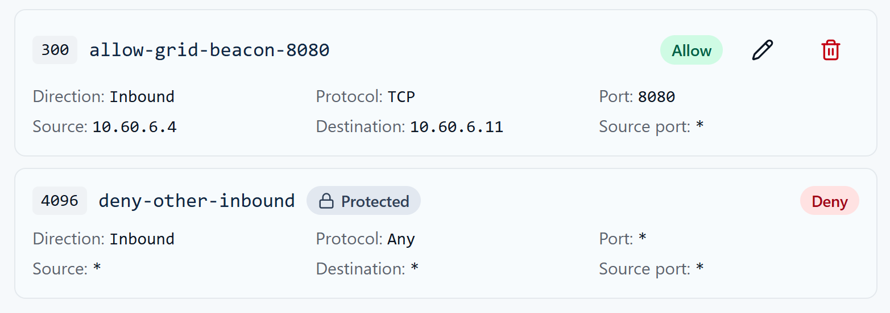
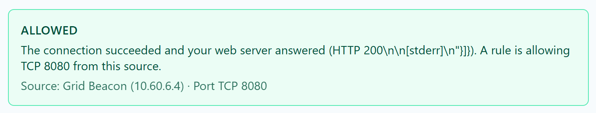
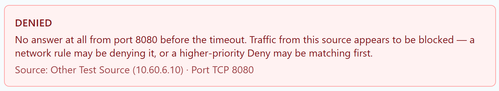

# Week 7 Lab 04 — Prove the Guard Works ★ Deliverable 2

**Student Name:** Joya Jones

**Date Completed:** 11/8/2026

**Module:** 2 — Networking & Cloud Foundations | **Week:** 7  
**Submission Path:** `week-07/labs/lab-04-prove-the-guard-works.md`

> ## Cloud Heights Protected-Rules Safety Rule
> Your room uses one of two protected baselines. Check your own **INBOUND — EVALUATION ORDER** list to see which one you have:
>
> | Baseline | Protected rules you will see | Fallback for TCP 8080 |
> |---|---|---|
> | **Legacy (four rules)** | 100 `allow-ssh-from-bastion`, 110 `allow-icmp-intra-vnet`, 120 `deny-ssh-student-subnet`, 1000 `deny-tcp8080-student-subnet` | Priority **1000** denies TCP 8080 from `10.60.6.0/26` |
> | **Newer (three rules)** | 100 `allow-ssh-from-bastion`, 110 `allow-icmp-intra-vnet`, 4096 `deny-other-inbound` | Priority **4096** explicitly denies all other inbound traffic (any protocol, source and port) |
>
> **Protected** rules (priorities 100/110, plus 120 and 1000 in legacy rooms, or 4096 in newer rooms) are course infrastructure: they are locked, and you must never modify them. Azure also has built-in default rules (priorities 65000–65500) that the Portal does not list; do not record them unless your ledger actually shows them. **Your editable range is 200–999.** Every student rule is read before either fallback. Write down the rule set your Portal actually shows; do not copy rules from the other baseline or invent missing ones. Use only inbound TCP 8080 rules from `10.60.6.4` to your assigned VM in Labs 03–05; never create SSH, ICMP, Any-protocol or outbound rules for these exercises. Bastion SSH and ICMP are matched by the earlier protected allows at 100/110 in both baselines. Honest diagnosis of a student-range mistake is not a grading penalty.

> **Evidence safety:** Never include a Cloud Heights password or Bastion shareable URL. Crop browser address bars and login information before committing screenshots.

---

## Mission

Assemble Deliverable 2 evidence by proving both halves of least privilege: the intended source is allowed and an unintended source is denied. A single successful test is not enough.

## What You Already Know

A network security rule is a decision about traffic. Rules are evaluated from the lowest priority number to the highest, and the first matching rule wins. Inbound and outbound traffic use separate ledgers. A configured service, a security rule, a test result, and an evidence screenshot answer different questions.

## Lab Environment / Pre-Lab Check

| Component | Details |
|---|---|
| Required setup | Lab 03 rule present; Python listener still running |
| Allowed source | Grid Beacon — `10.60.6.4` |
| Unintended source | Other Test Source — `10.60.6.10` |
| Deliverable | Security group configuration + verification evidence |
| Time | 30–40 minutes |

- [x] I am using my assigned `cf-student-XX` VM through the CyberFoundations Lab Portal.

- [x] The VM shows **Running**.

- [x] I can identify every protected rule in my actual baseline (legacy 100/110/120/1000 or newer 100/110/4096).

- [x] I understand that my editable priority range is 200–999.

### Cloud Heights Idle Stop

Cloud Heights may warn you that the VM is idle. Return to the Lab Portal and choose **I'm still working** if you are active. If the VM is stopped or deallocated, it was not deleted: restart it from **My Lab Environment**. Your disk files and saved configuration remain.

## Predict First

**Prerequisite from Lab 03 (required):** the Python listener is running on TCP 8080, and your narrow inbound Allow for `10.60.6.4` port `8080` exists in priorities **200–999**. If either is missing, finish Lab 03 first.

**Expected results:** Grid Beacon `10.60.6.4` is **ALLOWED** by your student Allow; Other Test Source `10.60.6.10` is **DENIED** by the protected fallback in your actual ledger: **1000** `deny-tcp8080-student-subnet` on legacy rooms or **4096** `deny-other-inbound` on newer rooms.

**DO NOT** create an additional deny rule, broaden your allow, or modify any protected rule to produce these results.

Without changing the Lab 03 rule, predict the result from each test source.

| Source | Prediction | Deciding rule/reason |
| --- | --- | --- |
| Grid Beacon `10.60.6.4` | ALLOW | 300 allow-grid-beacon-8080 |
| Other Test Source `10.60.6.10` | DENY | 4096 deny-other-inbound |

## Guided Steps

### Step 1 — Verify the Final Configuration

Confirm the listener is running and the student Allow remains inbound TCP 8080 from exactly `10.60.6.4`.

### Step 2 — Test the Intended Source

Select **Grid Beacon (10.60.6.4)** and run **Test My Rule**. Record the verdict and compare it with your prediction.

```text
ALLOWED. Result indicates that a rule is allowing TCP 8080 from Grid Beacon, although it does not name the rule.
```

### Step 3 — Test the Unintended Source

Wait at least 10 seconds. Select **Other Test Source (10.60.6.10)** and run the same fixed TCP 8080 test.

```text
DENIED. Result indicates a network rule may be denying it, or a higher priority Deny might be matching first.
```

Expected verdict: `DENIED`, produced by the protected fallback (1000 on legacy rooms; 4096 on newer rooms).

If either result differs from expected, **stop making changes**: capture the complete rule list in evaluation order plus the test result, and report it to your instructor in this worksheet. Do not add a deny rule, broaden the allow, or modify protected rules.

## Stop & Check

Your evidence pair should now prove:

- the intended connection is permitted;
- the unintended connection is not permitted;
- the service was listening during both tests;
- the rule source is narrow rather than Any.

## Test Summary

| Evidence question | Result |
| --- | --- |
| Is the service listening? | Yes |
| Is Grid Beacon allowed? | Yes |
| Is Other Test Source denied? | Yes |
| Which rule produces the intended Allow? | 300 allow-grid-beacon-8080 |

## Capture Evidence

Capture the final rule plus both result cards. Screenshots must show the selected source and verdict. These images are the core evidence for Deliverable 2.







## Explain — Deliverable 2 Statement

Write a concise professional statement covering what you configured, the source/port scope, the two tests, and how the results prove least privilege.

```text
I had the task of configuring a rule in my student Cloud Heights VM inbound ledger to allow only inbound traffic from Grid Beacon to reach the Python service via TCP on port 8080. To do so, I created an ALLOW rule named "allow-grid-beacon-8080" at Priority 300, using TCP from source 10.60.6.4 on any source port to destination 10.60.6.11 on port 8080. Traffic that does not match an earlier Allow rule is subject to the protected baseline rule at Priority 4096, "deny-other-inbound," which denies all other inbound traffic. The first test ran a connection attempt to TCP 8080 on my VM from Grid Beacon, and the second test ran an attempt to the same destination using the same protocol, but from the Other Test Source. The Grid Beacon test resulted in an ALLOW, as predicted given the conditions of rule 300. The Other Test Source test resulted in a DENY after the connection timed out, indicating that traffic from a source not explicitly authorized by the ALLOW rule was unable to reach the service at the time of testing. Together, these results demonstrate least privilege by showing that the rule permits the required network traffic without unnecessarily extending access to other sources.
```

## Required Evidence

Save screenshots in `assets/screenshots/week-07/`:

- `week07-lab04-final-rule.png`
- `week07-lab04-grid-beacon-allowed.png`
- `week07-lab04-other-source-denied.png`

Open each image at full size before submission. Confirm that no password, Bastion shareable URL, browser address bar, or unrelated private information is visible.

## Analysis Questions

**Analysis Question 1.** Why are one ALLOWED result and one DENIED result stronger evidence together than either result alone? (Minimum 4 sentences.)

```text
An ALLOWED result tells us that the intended source was able to connect to the service, but it does not establish whether other sources would also be allowed. A DENIED result tells us that a connection from the tested source was unsuccessful, but it doesn't establish whether the intended connection works. By testing both sources, we can determine whether the results match the authorization requirements of our security rules. It is how we secure evidence that we are allowing in who we intend to, without unnecessarily permitting access to other sources.
```

**Analysis Question 2.** If the Other Test Source were ALLOWED, what would you inspect before changing anything? (Minimum 4 sentences.)

```text
If the Other Test Source were ALLOWED, I would first review the inbound NSG rules to determine why the connection was permitted. I would check the source IP addresses, destination ports, protocols, and priorities of the existing rules to see whether a broader ALLOW rule could be responsible. Since rules are evaluated in priority order, a matching ALLOW rule with a lower priority number could permit the traffic before it reaches the protected DENY rule at Priority 4096. I would compare the configuration with the test results and identify the possible cause before making any changes.
```

**Analysis Question 3.** How does this evidence distinguish configuration from observed enforcement? (Minimum 3 sentences.)

```text
The configuration tells us what traffic our security rules are supposed to allow or deny, but it does not prove that they are working as intended. The ALLOWED result from Grid Beacon and the DENIED result from the Other Test Source show us what actually happened when those connections were tested. By comparing the expected behavior with the actual results, we have evidence that the network is enforcing the intended restrictions, rather than simply assuming that the rules are working because they were configured.
```

## Submission Checklist

- [x] Final rule screenshot shows narrow source and TCP 8080

- [x] Grid Beacon `ALLOWED` evidence captured

- [x] Other Test Source `DENIED` evidence captured

- [x] Deliverable 2 statement completed

- [x] `week07-lab04-final-rule.png` captured

- [x] `week07-lab04-grid-beacon-allowed.png` captured

- [x] `week07-lab04-other-source-denied.png` captured

- [x] All protected rules in my actual baseline were left unchanged.

- [x] Every rule I created or edited used priority 200–999.

- [x] No password, Bastion URL, or browser address bar appears in my files.

- [x] This worksheet is committed to `week-07/labs/lab-04-prove-the-guard-works.md`.

## GitHub / Lab Portal Submission

1. Open **Week 7 → Lab 04: Prove the Guard Works ★ Deliverable 2** in the CyberFoundations Lab Portal.
2. Complete every worksheet field and confirm the listed evidence filenames.
3. Upload screenshots to `assets/screenshots/week-07/`.
4. Confirm your portfolio repository is connected, then choose **Submit to GitHub**.
5. Open the committed worksheet and each image on GitHub to verify formatting, legibility, and redaction.

*CyberVisionaries Institute · CyberFoundations · Tier I*

**Interpreting results:** A TCP connection success proves reachability at that moment, not which rule matched. A timeout marked DENIED means traffic appears blocked; it is not a flow-log verdict and can also reflect a routing or host-firewall problem. SERVICE_NOT_LISTENING means an immediate refusal; check the listener before altering rules. TEST_ERROR is not denial evidence. Each test opens a fresh connection; after a rule change, allow Azure to finish, refresh the ledger and wait at least 10 seconds before retesting. Never invent a successful or denied result.
